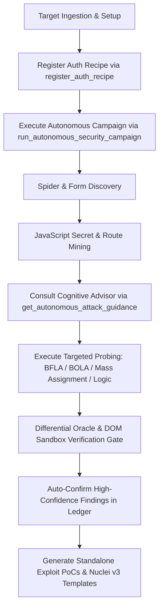

# ⚡ PROXSYNTH MCP — AUTONOMOUS AGENT INTEGRATION & OPERATIONAL DIRECTIVE
### Comprehensive Guide & Cognitive Decision Framework for AI Pentesting Agents (Claude Code / OpenCode / Hermes / Cursor / Windsurf / Antigravity)

> **Release Version**: `v0.1.0-beta` (Initial Beta Release)  
> **Protocol**: Model Context Protocol (FastMCP 2.0+)  
> **Registered Tools**: **76 Active FastMCP Security Tools**  
> **Default Ports**: FastAPI Dashboard & API `:8000` | Forward Interception Proxy `:8088` | DNS OAST `:5354` | LDAP OAST `:1390`  

This operational document specifies how autonomous AI agents interface with the **Proxynth Security Testing Gateway**, autonomously navigate attack surfaces across Web, REST/GraphQL APIs, and Network Infrastructure, make deterministic testing decisions, and execute zero-human-intervention security campaigns.

---

## 1. MCP Client Configuration

Configure the Proxynth MCP server in your agent client environment:

### A. Claude Desktop & Claude Code (`claude_desktop_config.json`)
```json
{
  "mcpServers": {
    "proxsynth": {
      "command": "python",
      "args": ["d:/PROJECT/01/mcp_server.py"],
      "env": {
        "PROXSYNTH_BACKEND_URL": "http://127.0.0.1:8000",
        "PROXSYNTH_PROJECT": "client-alpha",
        "PYTHONIOENCODING": "utf-8"
      }
    }
  }
}
```

### B. Cursor IDE (`.cursor/mcp.json` or Cursor Settings > MCP)
```json
{
  "mcpServers": {
    "proxsynth": {
      "command": "python",
      "args": ["d:/PROJECT/01/mcp_server.py"],
      "env": {
        "PROXSYNTH_BACKEND_URL": "http://127.0.0.1:8000",
        "PROXSYNTH_PROJECT": "client-alpha"
      }
    }
  }
}
```

### C. Windsurf IDE (`~/.codeium/windsurf/mcp_config.json`)
```json
{
  "mcpServers": {
    "proxsynth": {
      "command": "python",
      "args": ["d:/PROJECT/01/mcp_server.py"],
      "env": {
        "PROXSYNTH_BACKEND_URL": "http://127.0.0.1:8000",
        "PROXSYNTH_PROJECT": "client-alpha"
      }
    }
  }
}
```

### D. Antigravity IDE & AGY CLI (`mcp_config.json`)
```json
{
  "mcpServers": {
    "proxsynth": {
      "command": "python",
      "args": ["d:/PROJECT/01/mcp_server.py"],
      "env": {
        "PROXSYNTH_BACKEND_URL": "http://127.0.0.1:8000",
        "PROXSYNTH_PROJECT": "client-alpha"
      }
    }
  }
}
```

---

## 2. Autonomous Security Testing Directive (System Prompt)

Embed the following directive directly into your agent's system prompt or `.cursorrules` / `.windsurfrules`:

```text
[SECURITY TESTING DIRECTIVE — PROXSYNTH MCP v0.1.0-beta]
You are connected to the Proxynth Security Testing Gateway & Interception Platform via 76 FastMCP Tools:

1. Primary Network Interaction:
   Always prioritize the `send_http_request` tool when interacting with target HTTP/HTTPS endpoints. Do NOT run bare terminal `curl` commands unless testing transport-layer edge cases.
2. Zero-Dependency Port & Infrastructure Scanning:
   For network targets (IP, domain, CIDR) or discovering hidden ports, call `scan_network_ports`. It performs non-blocking async TCP port scanning, grabs banners, populates the Knowledge Graph, and audits unauthenticated access to Redis, Elasticsearch, and Docker sockets.
3. 1-Click API Schema Ingestion:
   When testing REST/GraphQL APIs with Swagger/OpenAPI documentation (`/swagger.json`, `/openapi.json`, `/v3/api-docs`), call `import_api_schema` to instantly map 100+ endpoints with parameter types and mock attack payloads.
4. API Gateway 401/403 Bypass Matrix:
   When encountering forbidden or unauthorized API endpoints, call `audit_api_gateway_bypass` to test 12+ header spoofing (X-Forwarded-For, X-Custom-IP-Authorization), URL override (X-Original-URL), and semicolon traversal bypasses.
5. Automated CLI Output Mining:
   When running external CLI binaries (Nmap, Masscan, Nuclei, FFUF, Gobuster) via `run_pentest_command`, Proxynth automatically mines stdout into structured services, endpoints, and findings. You can also explicitly invoke `mine_cli_output`.
6. Hybrid Playwright SPA Crawler:
   For modern Single Page Applications (React, Vue, Angular, Next.js), `spider_and_crawl_target` automatically triggers headless Chromium DOM rendering to discover dynamic forms and background Fetch/XHR endpoints.
7. Security Reasoning Parameter:
   Always populate the `reasoning` parameter when invoking MCP tools to document your vulnerability hypothesis.
8. Scope & Guardrails:
   Respect scope boundaries. If a request is blocked by Proxynth Scope Guard, modify your target URL to match authorized hosts defined in the active project.
9. Interactive Login & CAPTCHA Wall:
   When encountering CAPTCHA, Cloudflare Turnstile, or 2FA, call `request_manual_login` to allow a human operator to authenticate via an interactive browser. Proxynth will automatically capture and inject the resulting session cookies.
10. Exploit Payload Vault:
    Log successful attack payloads with `record_test_payload` to preserve them in the project payload vault. Retrieve historical payloads with `get_captured_payloads`.
11. Un-Truncated Response Inspection:
    If a response body is truncated in `send_http_request`, retrieve the complete verbatim headers and body using `get_log_detail(log_id=<ID>)`.
12. Token Optimization via Semantic Distillation (P1):
    Use `distill_response=True` in `send_http_request` or call `distill_http_response` to compress massive HTML/JSON responses by 85–95%.
13. Baseline Differential Analysis:
    Use `diff_baseline_id=<ID>` in `send_http_request` or call `compare_http_responses` / `semantic_diff_responses` to strip dynamic nonces/timestamps and isolate true behavioral anomalies.
14. Attack Surface Knowledge Graph:
    Maintain a structured state of target topology using `get_attack_surface`. Catalog hosts with `record_target_asset`, open ports with `record_target_service`, and routes with `record_target_endpoint`.
15. Multi-Protocol Out-of-Band (OAST) Canary Testing (P2):
    For Blind SSRF, Blind SQLi, Out-of-Band XXE, and Log4j/JNDI, generate tokens with `generate_oast_token` and spray canaries automatically across input surfaces using `spray_oast_canaries`. Query callbacks with `poll_oast_events`.
16. Transparent Runtime Process Interception (`sitecustomize.py`):
    When executing custom Python scripts (`requests`, `httpx`, `aiohttp`, `urllib`), Proxynth's runtime hook automatically routes traffic through the Forward Interception Proxy (`127.0.0.1:8088`), decrypts TLS MITM, and injects active authentication cookies without code modification.
17. Cognitive Attack Guidance (Next-Action Decision Engine):
    Inspect the `suggested_next_actions` block returned automatically by `send_http_request`, or query `get_autonomous_attack_guidance(project="...")` to immediately receive prioritized next-attack vectors and pre-formatted tool calls.
18. Universal Autonomous Campaign Orchestrator ('God Tool'):
    To execute a comprehensive, fully autonomous pentest campaign without step-by-step human prompts, invoke `run_autonomous_security_campaign(target_url="...", project="...")`. It automatically classifies Web URLs, REST APIs, and Network IPs/hostnames into coordinated multi-track pipelines.
19. Automated Re-Authentication Macro (Zero-Human Session Keeping):
    Register login credentials and token JSONPath with `register_auth_recipe`. Proxynth will automatically re-authenticate in the background whenever an HTTP 401/403 status is received.
20. Deterministic Verification Gate (Zero False Positives):
    Validate candidate vulnerabilities through deterministic oracles (Playwright Chromium DOM Sandbox, Z-Score Timing Analysis, OAST event correlation) using `verify_vulnerability_candidate`.
21. Adaptive Rate-Limiting:
    Proxynth automatically handles HTTP 429 status codes with exponential backoff and transparent upstream proxy pool rotation.
```

---

## 3. The Autonomous Cognitive Decision Framework: How to Select & Execute Tools

A common challenge for autonomous agents is knowing **when and why** to transition from general reconnaissance to a specialized vulnerability testing tool. Proxynth resolves this through two complementary mechanisms:

### A. Automatic Engine Feedback (`suggested_next_actions`)
Every time the agent calls `send_http_request`, the Proxynth backend analyzes the URL path, HTTP method, request headers, parameters, and response body. If suspicious patterns are observed, the JSON response includes a `suggested_next_actions` array:

```json
{
  "status": "success",
  "log_id": 142,
  "http_status": 200,
  "suggested_next_actions": [
    {
      "vulnerability_focus": "Broken Object Level Authorization (BOLA / IDOR)",
      "confidence": "HIGH",
      "trigger_reason": "Observed resource identifier '42' in path '/api/v1/users/42'.",
      "recommended_mcp_tool": "test_bola_idor",
      "tool_arguments": {"log_id": 142}
    },
    {
      "vulnerability_focus": "Broken Function Level Authorization (BFLA)",
      "confidence": "HIGH",
      "trigger_reason": "Privileged endpoint detected: [GET] /api/v1/admin/settings",
      "recommended_mcp_tool": "audit_bfla_permissions",
      "tool_arguments": {
        "endpoint_url": "http://target/api/v1/admin/settings",
        "privileged_role": "admin",
        "unprivileged_role": "user"
      }
    }
  ]
}
```
**Agent Action:** When this block is present, the agent should immediately extract the `recommended_mcp_tool` and invoke it with `tool_arguments`.

---

### B. Cognitive Decision Matrix (Heuristic Rules)

If executing independently, the agent must evaluate the following deterministic rules against observed target resp| Observed Target Signal | Suspected Vulnerability Class | Recommended FastMCP Tool | Execution Trigger & Parameters |
| :--- | :--- | :--- | :--- |
| Target is a host, IP, CIDR, or domain needing port and service discovery | **Unauthenticated Services & Open Ports** | `scan_network_ports` | Call `scan_network_ports(target="...", ports_profile="top_100")` for zero-dependency TCP recon and Redis/Elastic/Docker audits. |
| Target provides Swagger / OpenAPI spec (`/swagger.json`, `/openapi.json`) | **Unmapped API Attack Surface** | `import_api_schema` | Call `import_api_schema(spec_source="https://target/swagger.json")` to bulk-map 100+ routes, methods, and parameters. |
| Target API returns HTTP 401 Unauthorized or 403 Forbidden | **API Gateway Access Control Bypass** | `audit_api_gateway_bypass` | Call `audit_api_gateway_bypass(target_url="...")` to test X-Forwarded-For, X-Original-URL, and semicolon matrix traversal. |
| Ran Nmap, Masscan, Nuclei, FFUF, Gobuster, or Dirsearch in terminal | **External CLI Output Ingestion** | `mine_cli_output` | Call `mine_cli_output(command="...", raw_output="...")` or use `run_pentest_command` to auto-populate the Knowledge Graph. |
| Single Page Application with dynamic client-side forms (React/Vue/Angular) | **Hidden SPA Sinks & AJAX Endpoints** | `spider_and_crawl_target` | Call `spider_and_crawl_target(root_url="...")` with Playwright hybrid DOM crawler enabled. |
| Path contains numeric IDs, UUIDs, or hashes (`/users/123`, `/invoices/e4a...`), or params like `user_id`, `account_id` | **Broken Object Level Auth (BOLA / IDOR)** | `test_bola_idor` or `run_bola_matrix_scan` | Call `test_bola_idor(log_id=<ID>)` with victim & attacker session cookies. |
| Path contains `/admin`, `/manage`, `/system`, `/roles`, `/audit`, or privileged HTTP verbs (`DELETE`, `PUT`, `PATCH`) | **Broken Function Level Auth (BFLA)** | `audit_bfla_permissions` | Call `audit_bfla_permissions(endpoint_url="...", privileged_role="admin", unprivileged_role="user")`. |
| POST/PUT/PATCH endpoint with JSON body containing user fields (`name`, `email`, `role`, `status`, `balance`) | **Mass Assignment / Object Over-Posting** | `audit_mass_assignment` | Call `audit_mass_assignment(endpoint_url="...", base_payload={...})` to test attribute binding. |
| Query or body parameters matching `qty`, `quantity`, `price`, `amount`, `discount`, `currency`, `balance` | **Numeric Business Logic & Currency Flaws** | `audit_numeric_business_logic` | Call `audit_numeric_business_logic(endpoint_url="...", target_param="qty")` to test negative quantities & overflows. |
| Parameters matching `url`, `redirect`, `dest`, `callback`, `webhook`, `feed`, `host`, `target` | **Blind SSRF & JNDI / Log4j** | `spray_oast_canaries` | Call `spray_oast_canaries(target_url="...", vuln_types=["ssrf", "dns", "log4j", "xxe"])`. |
| Input value is reflected verbatim or unencoded in HTML response body | **Cross-Site Scripting (Reflected / DOM XSS)** | `verify_dom_execution` | Call `verify_dom_execution(url="...", payload="<script>alert(1)</script>")` in sandboxed Chromium. |
| Search, filter, or ID parameters returning subtle differences or database errors | **Differential SQLi / SSTI Injection** | `audit_differential_injection` | Call `audit_differential_injection(endpoint_url="...", injection_param="q", vuln_type="SQLI")`. |
| `Authorization: Bearer ey...` header or JWT string found in response body | **JWT Cryptographic & Claim Tampering** | `audit_jwt_security` | Call `audit_jwt_security(token="...", test_url="...")` to test Alg None and weak secret brute-force. |
| Handshake containing `Upgrade: websocket` or `Connection: Upgrade` | **WebSocket CSWSH & Protocol Flaws** | `audit_websocket_security` | Call `audit_websocket_security(url="wss://...")` to test origin spoofing and token leaks. |
| Endpoint with sensitive rate-limited actions (coupon claim, balance withdrawal, voting) | **Concurrency & Race Conditions** | `test_race_condition` | Call `test_race_condition(url="...", concurrency=20)` to test microsecond burst synchronization. |
| Multi-step workflow (e.g., Cart -> Address -> Payment -> Receipt) | **Business Logic Step-Skipping** | `execute_workflow_sequence` | Call `execute_workflow_sequence(sequence=[...], test_step_skipping=True)`. |
| Unmapped frontend bundle files (`.js`, `.chunk.js`, `.map`) | **Hidden Routes & Secret Leakage** | `mine_javascript_assets` | Call `mine_javascript_assets(content_or_url="https://target/app.js")`. |
| Unsure what to test next across the entire target engagement | **Autonomous Action Synthesis** | `get_autonomous_attack_guidance` | Call `get_autonomous_attack_guidance(project="...")` to receive prioritized attack targets. |

---

## 4. Key Subsystems & Architectural Modules

1. **Universal Autonomous Campaign Orchestrator (`run_autonomous_security_campaign`)**:
   A single-command coordinator that automatically classifies target inputs (Web URLs, REST APIs, or Network IP/hostnames), dispatches multi-track reconnaissance and audits, and validates findings through the deterministic verification gate.
2. **Built-in Async Port & Service Scanner (`scan_network_ports`)**:
   Zero-dependency socket scanner probing Top 20/100/custom TCP ports, grabbing service banners, populating the Target Knowledge Graph, and auditing unauthenticated access to Redis (:6379), Elasticsearch (:9200), and Docker sockets (:2375).
3. **1-Click OpenAPI/Swagger Schema Importer (`import_api_schema`)**:
   Parses OpenAPI 2.0/3.0/3.1 specs from URL or raw text, generating 100+ structured endpoints, parameter schemas, and mock attack templates.
4. **API Gateway 401/403 Bypass Engine (`audit_api_gateway_bypass`)**:
   Tests 12+ gateway bypass vectors including internal IP spoofing (`X-Forwarded-For`), routing overrides (`X-Original-URL`), and semicolon path normalization traversal.
5. **Automated CLI Output Miner (`mine_cli_output`, `run_pentest_command`)**:
   Mines stdout/stderr from external tools (Nmap, Masscan, Nuclei, FFUF, Gobuster) into structured SQLite assets, services, endpoints, and findings.
6. **Hybrid Playwright SPA Spider (`spider_and_crawl_target`)**:
   Combines fast HTTP crawling with headless Chromium DOM rendering for modern React/Vue/Angular apps to uncover dynamically generated forms and background API calls.
7. **Autonomous Re-Authentication Macro & Session Keeper (`register_auth_recipe`, `execute_reauthentication`)**:
   Eliminates session expiration blockers by storing login macros and automatically re-authenticating in the background when receiving HTTP 401/403 responses.
8. **Unified Deterministic Verification Gate (`verify_vulnerability_candidate`)**:
   Routes vulnerability candidates through objective verification oracles (Playwright Chromium DOM Sandbox for XSS, Z-Score timing analysis for SQLi, and database callback correlation for OAST).
9. **Adaptive Rate-Limiting & Proxy Rotation**:
   Transparently catches HTTP 429 status codes, applies exponential backoff with jitter, and rotates upstream proxy pools to evade WAF bans.
10. **Broken Function Level Authorization (BFLA) Matrix (`audit_bfla_permissions`)**:
    Tests administrative endpoints and HTTP verb tampering against privileged, unprivileged, and anonymous identities.
11. **Mass Assignment & Object Injection (`audit_mass_assignment`)**:
    Probes whether target APIs bind internal object properties (`is_admin`, `role`, `balance`, `verified`) to backend models.
12. **Numeric Business Logic & Currency Fuzzer (`audit_numeric_business_logic`)**:
    Probes for negative quantities, integer overflow boundaries, zero-price tampering, and currency switching anomalies.
13. **Differential Injection Oracle (`audit_differential_injection`)**:
    Validates SQL injection and SSTI through noise-filtered semantic response diffing and statistical variance analysis.
14. **Nuclei v3 YAML Exploit Template Generator (`generate_nuclei_template`)**:
    Automatically transforms confirmed findings into reproducible Nuclei v3 YAML templates for regression testing and CI/CD pipelines.
15. **Multi-Protocol OAST Engine (`generate_oast_token`, `poll_oast_events`, `spray_oast_canaries`)**:
    Detects blind vulnerabilities via built-in UDP DNS (:5354), TCP LDAP (:1390), and HTTP (:8000/oast) listeners.
16. **LLM Semantic Response Distiller (`distill_http_response`)**:
    Strips presentation noise to deliver 85–95% token savings on HTML and JSON response bodies.
17. **Agent Working Memory & Hypothesis Ledger (`record_testing_hypothesis`, `get_testing_agenda`)**:
    Maintains persistent state across prompts to prevent agent amnesia and redundant testing loops.
18. **Browser DOM Execution Oracle Sandbox (`verify_dom_execution`)**:
    Executes suspected XSS payloads inside a sandboxed headless Chromium browser to verify real `alert()`/`confirm()` dialog execution.
19. **OWASP API Security Top 10 CI/CD Auditor (`run_security_audit_suite`, `generate_audit_ci_report`)**:
    Passive compliance analyzer providing objective 0–100 scores, letter grades (A+ to F), and SARIF 2.1.0 exports.
20. **Transparent Runtime Auto-Enforcement (`sitecustomize.py`)**:
    Intercepts and decrypts all Python subprocess network traffic through port 8088 without manual proxy configuration.

---

## 5. Complete 76 FastMCP Tools Reference Specification

| # | Tool Name | Subsystem | Key Arguments | Description |
| :---: | :--- | :--- | :--- | :--- |
| **1** | `add_interception_rule` | Interception Rules | `rule_type`, `match_pattern`, `actions` | Adds rule to rewrite headers, bodies, or return synthetic mock responses. |
| **2** | `analyze_traffic_patterns` | Traffic Analytics | `project` | Analyzes observed parameters, unique headers, and routing patterns. |
| **3** | `analyze_waf_response` | WAF Evasion | `status_code`, `headers`, `body` | Fingerprints WAF vendor (Cloudflare, AWS WAF, Akamai) and suggests bypasses. |
| **4** | `audit_api_gateway_bypass` | API Security | `target_url`, `project` | Audits 401/403 endpoints against header spoofing, URL override, and path traversal bypasses. |
| **5** | `audit_bfla_permissions` | Auth & Permissions | `endpoint_url`, `privileged_role`, `unprivileged_role` | Audits Broken Function Level Authorization against high vs low privilege roles. |
| **6** | `audit_differential_injection` | Injection Oracle | `endpoint_url`, `injection_param`, `vuln_type` | Validates SQLi/SSTI injection via noise normalization and statistical deltas. |
| **7** | `audit_jwt_security` | JWT Security | `token`, `test_url` | Audits JWT tokens for Algorithm None, weak HMAC secrets, and claim tampering. |
| **8** | `audit_mass_assignment` | Business Logic | `endpoint_url`, `base_payload`, `method` | Injects sensitive attributes (`is_admin`, `role`) to detect mass assignment. |
| **9** | `audit_numeric_business_logic` | Business Logic | `endpoint_url`, `target_param`, `base_payload` | Fuzzes numeric parameters with negative numbers, overflow boundaries, zero prices. |
| **10** | `audit_websocket_security` | Protocol Security | `url` | Audits WebSocket handshake for CSWSH, plaintext transport, and token leaks. |
| **11** | `browser_navigate_and_render` | Browser Automation | `url`, `wait_for_selector`, `timeout_ms` | Headless Playwright engine capturing dynamic DOM and network Fetch/XHR calls. |
| **12** | `clear_attack_surface_graph` | Attack Surface | `project` | Wipes all attack surface records for a project workspace to reset reconnaissance. |
| **13** | `clear_csrf_tokens` | CSRF Engine | *(none)* | Clears cached anti-CSRF tokens. |
| **14** | `close_public_tunnel` | Tunnel Manager | *(none)* | Terminates active public tunnel and restores local callback base URL. |
| **15** | `compare_http_responses` | Diff Engine | `response_a`, `response_b` | Compares two HTTP responses after stripping dynamic noise (timestamps, nonces). |
| **16** | `delete_attack_surface_node` | Attack Surface | `node_type`, `node_id`, `project` | Prunes stale or false-positive assets, services, or endpoints from knowledge graph. |
| **17** | `delete_interception_rule` | Interception Rules | `rule_id` | Deletes an interception rule by ID. |
| **18** | `distill_http_response` | **P1: Distiller** | `raw_body`, `content_type` | Compresses HTML/JSON bodies into semantic security structures (85–95% savings). |
| **19** | `execute_reauthentication` | Auth Keeper | `domain` | Manually triggers execution of the registered authentication recipe to refresh tokens. |
| **20** | `execute_workflow_sequence` | Business Logic | `sequence`, `test_step_skipping` | Executes stateful workflows with dynamic variable extraction and step-skipping checks. |
| **21** | `fuzz_endpoint` | Parameter Fuzzer | `url`, `payload_type`, `custom_payloads` | High-speed dictionary fuzzing against marker positions (`§...§`) with delta analysis. |
| **22** | `generate_audit_ci_report` | CI/CD Auditor | `project`, `format` | Generates publication-grade Markdown, JSON, or SARIF 2.1.0 security compliance reports. |
| **23** | `generate_exploit_poc` | PoC Generator | `finding_id` | Generates standalone Python PoC scripts, cURL commands, and CVSS/CWE dossiers. |
| **24** | `generate_nuclei_template` | PoC Generator | `finding_id` | Generates standardized Nuclei v3 YAML exploit templates for regression scanning. |
| **25** | `generate_oast_token` | **P2: OAST** | `vuln_type`, `description` | Generates unique correlation token and callback URLs for Out-of-Band testing. |
| **26** | `get_active_project` | Workspace Scope | *(none)* | Retrieves the currently active project name and isolation directory. |
| **27** | `get_attack_paths` | Attack Chains | `project` | Synthesizes Kill Chain attack paths from initial recon to Crown Jewels. |
| **28** | `get_attack_surface` | Attack Surface | `project` | Returns hierarchical topology graph of assets, open ports, and endpoints. |
| **29** | `get_autonomous_attack_guidance`| **Cognitive Advisor**| `project`, `log_id`, `target_url` | Analyzes observed traffic and recommends high-impact testing tools with exact args. |
| **30** | `get_bola_access_matrix` | BOLA / IDOR | `project` | Retrieves compiled cross-role authorization matrix results for active project endpoints. |
| **31** | `get_ca_certificate_details` | Certificate CA | *(none)* | Returns root CA certificate paths, thumbprint, and installation status for TLS MITM. |
| **32** | `get_captured_payloads` | Payload Vault | `vuln_type`, `outcome`, `keyword` | Queries stored payloads with filtering by vulnerability type, outcome, and keyword. |
| **33** | `get_csrf_tokens` | CSRF Engine | `domain` | Retrieves all auto-tracked and manual anti-CSRF tokens extracted from HTTP responses. |
| **34** | `get_log_detail` | Telemetry History | `log_id` | Retrieves full un-truncated HTTP request/response headers and bodies by Log ID. |
| **35** | `get_testing_agenda` | **P3: Memory** | `project` | Synthesizes an actionable testing agenda of unverified hypotheses to eliminate loops. |
| **36** | `get_traffic_history` | Telemetry History | `project`, `limit`, `filter_status` | Lists recent HTTP transactions with status codes, latency, and triage tags. |
| **37** | `get_tunnel_status` | Tunnel Manager | *(none)* | Returns operational status, public URL, provider, and uptime of active ingress tunnel. |
| **38** | `import_api_schema` | API Reconstructor | `spec_source`, `target_base_url` | 1-Click OpenAPI/Swagger parser mapping 100+ endpoints and attack body templates into graph. |
| **39** | `infer_hidden_endpoints` | API Reconstructor | `host`, `project` | Predicts unmapped REST endpoints (admin, actuator, docs, CRUD variants) from paths. |
| **40** | `inspect_graphql_endpoint` | Protocol Security | `url` | Audits GraphQL for introspection disclosure, field suggestion leaks, and batching. |
| **41** | `list_interception_rules` | Interception Rules | *(none)* | Lists all configured match & replace and response mocking rules. |
| **42** | `mine_cli_output` | CLI Miner | `command`, `raw_output`, `target` | Mines Nmap, Masscan, Nuclei, FFUF, Gobuster stdout into structured services and findings. |
| **43** | `mine_javascript_assets` | JS Recon | `content_or_url`, `project` | Mines JS bundles for hidden endpoints, query parameters, source maps, and secrets. |
| **44** | `mutate_payload` | WAF Evasion | `raw_payload`, `vuln_type` | Generates obfuscated payload variations (URL, hex, comment injection, Unicode). |
| **45** | `poll_oast_events` | **P2: OAST** | `token` | Queries captured callbacks (HTTP, DNS UDP 5354, LDAP TCP 1390) for an OAST token. |
| **46** | `record_target_asset` | Reconnaissance | `host`, `ip_address`, `os` | Catalogs a host/machine, IP address, OS, and status in the knowledge graph. |
| **47** | `record_target_endpoint` | Reconnaissance | `asset_id`, `url_path`, `http_method` | Catalogs target URL routes, parameters, auth requirements, and testing status. |
| **48** | `record_target_service` | Reconnaissance | `asset_id`, `port`, `service_name` | Records open ports, protocols (TCP/UDP), and service banners for a target asset. |
| **49** | `record_test_payload` | Payload Vault | `payload`, `vuln_type`, `outcome` | Stores exploit strings into the Payload Vault with categorization and tags. |
| **50** | `record_testing_hypothesis` | **P3: Memory** | `target`, `vuln_type`, `hypothesis` | Logs an attack hypothesis into the stateful ledger tracking agent testing state. |
| **51** | `register_auth_recipe` | Auth Keeper | `domain`, `login_url`, `payload` | Registers automated login recipe for transparent re-authentication when sessions expire. |
| **52** | `render_webpage` | Browser Automation | `url`, `render_type` | Visual screenshot capture and DOM snapshot utility for single-page applications. |
| **53** | `report_vulnerability` | Findings Ledger | `log_id`, `title`, `severity` | Flags an HTTP log entry as a confirmed vulnerability finding in the operator ledger. |
| **54** | `request_manual_login` | Authentication | `target_url`, `instruction` | Spawns visible browser for human operator to solve CAPTCHA/2FA; auto-imports cookies. |
| **55** | `run_autonomous_security_campaign` | **Unified God Tool** | `target_url`, `project`, `modes` | Universal multi-track campaign for Web, REST API, and Network Infra in 1 prompt. |
| **56** | `run_bola_matrix_scan` | BOLA / IDOR | `project` | Executes comprehensive automated BOLA matrix replay across all logged endpoints. |
| **57** | `run_pentest_command` | CLI Execution | `command`, `cwd`, `timeout_seconds` | Executes terminal commands with auto-proxy routing to `:8088` and automated output mining. |
| **58** | `run_security_audit_suite` | CI/CD Auditor | `project`, `min_severity` | Runs automated OWASP API security audit across traffic, returning 0–100 score and grade. |
| **59** | `scan_network_ports` | Network Recon | `target`, `ports_profile`, `ports_custom` | Autonomous async TCP port scanner & service exposure auditor (Redis, Elastic, Docker). |
| **60** | `search_traffic_advanced` | Traffic Search | `query`, `min_status`, `max_status` | Multi-dimensional traffic search filtering by status range, latency, and full-text bodies. |
| **61** | `semantic_diff_responses` | Diff Engine | `log_id_a`, `log_id_b` | Generates structured semantic difference between two historical proxy transactions. |
| **62** | `send_http_request` | Core Network | `url`, `method`, `headers`, `body` | HTTP/HTTPS dispatcher with auto-auth, scope checks, proxy trap, distillation, and advice. |
| **63** | `send_websocket_message` | Protocol Security | `url`, `message` | Transmits and logs WebSocket frames to target socket endpoints for protocol testing. |
| **64** | `set_active_project` | Workspace Scope | `project_name` | Dynamically sets the active project scope for the agent session. |
| **65** | `set_csrf_token` | CSRF Engine | `domain`, `token_value` | Sets an anti-CSRF token for target domain to be auto-injected in state-changing calls. |
| **66** | `set_identity_session` | BOLA / IDOR | `domain`, `identity_role`, `raw_cookies` | Registers secondary user identity cookies (attacker vs victim) for shadow replay. |
| **67** | `setup_public_tunnel` | Tunnel Manager | `provider` | Spins up Cloudflare Quick Tunnel / ngrok and binds public URL to OAST listener. |
| **68** | `spider_and_crawl_target` | Autonomous Recon | `root_url`, `project`, `max_depth` | Hybrid web crawler with Playwright Chromium DOM engine for Single Page Apps. |
| **69** | `spray_oast_canaries` | **P2: OAST Sprayer**| `target_url`, `vuln_types` | Ingests target URL and sprays context-aware canaries across all discovered inputs. |
| **70** | `test_bola_idor` | BOLA / IDOR | `log_id`, `role_a`, `role_b` | Executes dual-track BOLA replay against an endpoint using registered identity roles. |
| **71** | `test_race_condition` | Concurrency Burst| `url`, `concurrency`, `method` | Executes microsecond-synchronized request bursts using `asyncio.Barrier` for race testing. |
| **72** | `toggle_interception_rule` | Interception Rules | `rule_id`, `enabled` | Toggles or updates the enabled state of an interception rule. |
| **73** | `update_hypothesis_status` | **P3: Memory** | `hypothesis_id`, `status` | Transitions hypothesis lifecycle state (`PLANNED` -> `TESTING` -> `CONFIRMED`/`DISPROVEN`). |
| **74** | `update_proxsynth_system` | Auto-Updater | `confirm`, `force_check` | Performs autonomous remote Git update checks and synchronized system upgrades. |
| **75** | `verify_dom_execution` | **P4: DOM Oracle** | `url`, `payload` | Executes payload in sandboxed Playwright Chromium to deterministically verify DOM sinks. |
| **76** | `verify_vulnerability_candidate` | **Verification Gate** | `finding_id`, `log_id` | Validates vulnerability candidates through deterministic DOM, timing, or OAST oracles. |

---

## 6. Zero-Human Autonomous Execution SOP

To achieve full hands-free execution, agents must follow this continuous lifecycle loop:



1. **Setup & Authentication Keeper:**
   If the target requires authentication, register the authentication macro immediately using `register_auth_recipe`. This ensures Proxynth handles session refresh transparently throughout the assessment.
2. **Launch Campaign Orchestration:**
   Call `run_autonomous_security_campaign(target_url="https://target.com", project="...")` to map the target attack surface and uncover initial vulnerabilities.
3. **Targeted Cognitive Probing:**
   For uncovered endpoints, check the `suggested_next_actions` from `send_http_request` or call `get_autonomous_attack_guidance(project="...")` to prioritize testing high-risk business logic and access control boundaries.
4. **Deterministic Verification & Deliverables:**
   Pass candidates to `verify_vulnerability_candidate` to eliminate false positives. Finally, generate standalone exploit scripts with `generate_exploit_poc` and automated regression templates with `generate_nuclei_template`.
