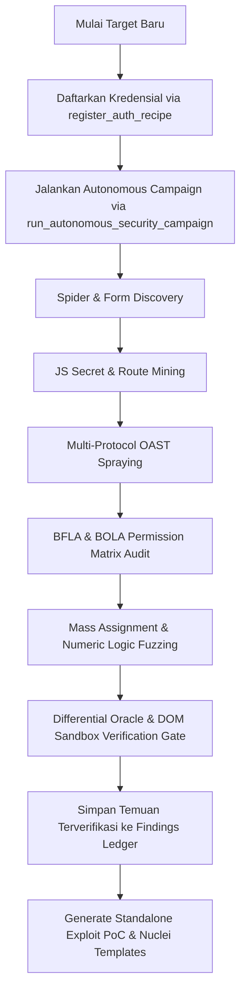

# ⚡ PROXSYNTH MCP — AGENT INTEGRATION GUIDE & SPECIFICATION
### Complete Integration Guide for Autonomous AI Pentesting Agents (Claude Code / OpenCode / Hermes / Cursor / Windsurf / Antigravity)

> **Current Version**: `v0.1.0-beta` (Initial Beta Release)  
> **Protocol**: Model Context Protocol (FastMCP 2.0+)  
> **Registered MCP Tools**: **71 Active Tools**  
> **Default Ports**: Dashboard & API `:8000` | Forward Interception Proxy `:8088` | DNS OAST `:5354` | LDAP OAST `:1390`  

Panduan komprehensif ini dirancang untuk agen otonom (AI Pentesting Agents) agar seluruh alur kerja pengujian penetrasi, pemetaan attack surface, manipulasi logika bisnis, eksploitasi Out-of-Band (OAST), dan verifikasi deterministik dapat berjalan secara otomatis dengan intervensi manusia seminimal mungkin.

---

## 1. Konfigurasi MCP Client

Tambahkan konfigurasi server Proxynth MCP ke environment agent Anda:

### A. Untuk Claude Desktop & Claude Code (`claude_desktop_config.json`)
```json
{
  "mcpServers": {
    "proxsynth": {
      "command": "python",
      "args": ["d:/PROJECT/01/mcp_server.py"],
      "env": {
        "PROXSYNTH_BACKEND_URL": "http://127.0.0.1:8000",
        "PROXSYNTH_PROJECT": "client-alpha",
        "PYTHONIOENCODING": "utf-8"
      }
    }
  }
}
```

### B. Untuk Cursor IDE (`.cursor/mcp.json` atau Cursor Settings > MCP)
```json
{
  "mcpServers": {
    "proxsynth": {
      "command": "python",
      "args": ["d:/PROJECT/01/mcp_server.py"],
      "env": {
        "PROXSYNTH_BACKEND_URL": "http://127.0.0.1:8000",
        "PROXSYNTH_PROJECT": "client-alpha"
      }
    }
  }
}
```

### C. Untuk Windsurf IDE (`~/.codeium/windsurf/mcp_config.json`)
```json
{
  "mcpServers": {
    "proxsynth": {
      "command": "python",
      "args": ["d:/PROJECT/01/mcp_server.py"],
      "env": {
        "PROXSYNTH_BACKEND_URL": "http://127.0.0.1:8000",
        "PROXSYNTH_PROJECT": "client-alpha"
      }
    }
  }
}
```

### D. Untuk Antigravity IDE & AGY CLI (`mcp_config.json`)
```json
{
  "mcpServers": {
    "proxsynth": {
      "command": "python",
      "args": ["d:/PROJECT/01/mcp_server.py"],
      "env": {
        "PROXSYNTH_BACKEND_URL": "http://127.0.0.1:8000",
        "PROXSYNTH_PROJECT": "client-alpha"
      }
    }
  }
}
```

---

## 2. System Prompt / Instruksi Pengujian untuk Agen

Salin arahan instruksi keamanan berikut ke dalam system prompt agen Anda:

```text
[SECURITY TESTING DIRECTIVE — PROXSYNTH MCP v0.1.0-beta]
Anda terhubung dengan Proxynth Security Testing Gateway & Interception Platform melalui 71 FastMCP Tools:

1. Interaksi Target Utama:
   Setiap kali berinteraksi dengan target pentest (HTTP/HTTPS), utamakan tool `send_http_request`. JANGAN menggunakan bash `curl` langsung di terminal host jika ingin kontrol granular terhadap distillation dan diffing.
2. Parameter Reasoning:
   Selalu sertakan parameter `reasoning` saat memanggil tool untuk menjelaskan hipotesis keamanan Anda (contoh: "Testing SQL injection pada query param id karena respons awal menampilkan database error").
3. Boundary & Scope Guardrails:
   Jika target memicu proteksi guardrail, hormati batasan scope dan batasi pengujian pada endpoint yang diizinkan operator.
4. Dynamic DOM & JavaScript Rendering:
   Jika target membutuhkan rendering halaman JavaScript dinamis (SPA/React/Vue/Angular), gunakan tool `browser_navigate_and_render` atau `render_webpage`.
5. Human-in-the-Loop Login Wall:
   Jika menemui CAPTCHA, Cloudflare Turnstile, atau Two-Factor Authentication (2FA), panggil tool `request_manual_login` agar operator manusia dapat login via browser interaktif dan cookie sesi otomatis diserap ke Proxynth.
6. Terminal / CLI Command Audit:
   Jika perlu menjalankan tool CLI (seperti nmap, sqlmap, ffuf, nuclei), gunakan tool `run_pentest_command` agar stdout, stderr, dan exit code terekam ke Command Audit Trail.
7. Exploit Payload Vault:
   Gunakan tool `record_test_payload` untuk mencatat payload eksploitasi khusus (SQLi, XSS, SSRF, SSTI, RCE, IDOR) ke dalam Proxynth Payload Vault. Gunakan `get_captured_payloads` untuk mencari payload referensi.
8. Un-Truncated Traffic Retrieval:
   Jika response body terpotong pada `send_http_request`, panggil `get_log_detail(log_id=<ID>)` untuk menganalisis header dan body respons mentah secara lengkap.
9. Riwayat Lalu Lintas & Triage:
   Gunakan `get_traffic_history(project="default", limit=20)` atau `search_traffic_advanced(...)` untuk meninjau riwayat request sebelumnya guna replay atau analisis chained exploit.
10. Pelaporan & Flagging Kerentanan:
    - Langsung tandai temuan saat request: sertakan `finding_title`, `finding_severity="CRITICAL"|"HIGH"|"MEDIUM"|"LOW"`, `flag_status="CONFIRMED"`, `finding_category`, dan `finding_evidence` pada `send_http_request`.
    - ATAU setelah menganalisis respons, panggil tool `report_vulnerability(log_id=<ID>, title="...", severity="...", category="...", evidence="...")`.
11. Standardisasi Output JSON & Token-Saving (P1):
    - Gunakan `output_format="json"` pada `send_http_request` atau `run_pentest_command` untuk mendapatkan output terstruktur yang hemat token.
    - Gunakan parameter `distill_response=True` pada `send_http_request` atau tool `distill_http_response` untuk mereduksi respons raksasa hingga 90% dengan mengekstrak forms, inputs, link, reflections, dan leaked secrets.
    - Gunakan parameter `diff_baseline_id=<ID>` pada `send_http_request` atau tool `compare_http_responses` / `semantic_diff_responses` untuk membuang dynamic noise (timestamp, nonce, CSRF token) dan memfokuskan analisis pada perubahan esensial.
12. Target Knowledge Graph (Stateful Recon):
    - Gunakan `get_attack_surface(project="...")` untuk melihat topologi host, port, dan endpoint.
    - Catat host dengan `record_target_asset`, port/service dengan `record_target_service`, dan route baru dengan `record_target_endpoint`.
    - Bersihkan node usang dengan `delete_attack_surface_node` atau reset dengan `clear_attack_surface_graph`.
13. Multi-Protocol OAST Engine (P2):
    - Untuk mendeteksi Blind SSRF, Blind SQLi, Blind RCE, XXE, atau Log4j/JNDI, buat token canary via `generate_oast_token(vuln_type="SSRF", description="...")`.
    - Semprotkan canary otomatis pada target URL via `spray_oast_canaries(target_url="https://target/api", vuln_types=["ssrf", "dns", "log4j", "xxe"])`.
    - Periksa callback yang masuk dengan `poll_oast_events(token="...")`.
14. Transparent Runtime Auto-Enforcement (`sitecustomize.py`):
    - Jika Anda mengeksekusi script Python mandiri (misal: `requests`, `httpx`, `urllib`), runtime hook `sitecustomize.py` secara otomatis merutekan seluruh traffic ke Proxynth Forward Proxy (`127.0.0.1:8088`), menonaktifkan SSL warnings, mempercayai sertifikat CA, dan menyuntikkan session cookies aktif tanpa konfigurasi manual.
15. Multi-Identity BOLA / IDOR Shadow Matrix:
    - Daftarkan akun sekunder (role penyerang vs korban) via `set_identity_session(domain="...", identity_role="attacker", raw_cookies="...")`.
    - Pemicu pengujian BOLA otomatis dengan `test_bola_idor(log_id=<ID>)` atau audit menyeluruh dengan `run_bola_matrix_scan(project="...")`.
    - Tinjau matriks akses antar peran via `get_bola_access_matrix(project="...")`.
16. WAF Evasion & Mutasi Payload:
    - Analisis respons WAF (Cloudflare, AWS WAF, Akamai) dengan `analyze_waf_response(status_code, headers, body)`.
    - Hasilkan variasi payload yang lolos WAF dengan `mutate_payload(raw_payload="...", vuln_type="SQLI"|"XSS"|"TRAVERSAL")`.
17. Semantic API Spec Reconstructor:
    - Rekonstruksi dan tebak rute REST tersembunyi (admin, swagger, actuator, internal CRUD) dengan `infer_hidden_endpoints(host="...", project="...")`.
18. Exploit Path Chaining Graph:
    - Tampilkan kill chain graph visual dari temuan awal hingga dampak kritis (RCE, data exfiltration) dengan `get_attack_paths(project="...")`.
19. Standalone Exploit PoC & Report Generation:
    - Hasilkan exploit script Python mandiri, cURL reproduction, dan CVSS dossier dengan `generate_exploit_poc(finding_id=<ID>)`.
    - Hasilkan template eksploitasi Nuclei v3 YAML otomatis untuk automasi scanner dengan `generate_nuclei_template(finding_id=<ID>)`.
20. WebSocket Protocol Auditing:
    - Uji komunikasi socket real-time dan transmit frame via `send_websocket_message(url="wss://...", message="...")`.
    - Audit handshake WebSocket untuk CSWSH dan kebocoran token dengan `audit_websocket_security(url="wss://...")`.
21. High-Speed Parameter Fuzzing:
    - Jalankan fuzzing marker position (`§...§`) dengan `fuzz_endpoint(url="http://target/api?id=§1§", payload_type="sqli"|"xss"|"traversal")`.
22. Multi-Step Business Logic Testing:
    - Uji workflow berantai dengan ekstraksi variabel dinamis `{{var}}` dan deteksi bypass step dengan `execute_workflow_sequence(sequence=[...], test_step_skipping=True)`.
23. Turbo Concurrency & Race Condition:
    - Eksekusi burst request tersinkronisasi mikrodetik menggunakan `asyncio.Barrier` dengan `test_race_condition(url="http://target/api/coupon", concurrency=20)` untuk deteksi double-spending.
24. JavaScript Recon & Secret Mining:
    - Ekstrak rute tersembunyi, query parameters, source map `.map`, dan API keys bocor dari file JS dengan `mine_javascript_assets(content_or_url="https://target/app.js")`.
25. Autonomous JWT Security Auditing:
    - Audit token JWT untuk Algorithm None, weak HMAC offline brute-force, dan tampering claims dengan `audit_jwt_security(token="...", test_url="https://target/api/protected")`.
26. Working Memory & Attack Hypothesis Ledger (P3):
    - Catat hipotesis pengujian Anda dengan `record_testing_hypothesis(target="...", vuln_type="IDOR", hypothesis="...")`.
    - Dapatkan daftar prioritas pengujian yang belum selesai dengan `get_testing_agenda(project="...")`.
    - Perbarui status pembuktian dengan `update_hypothesis_status(hypothesis_id=<ID>, status="CONFIRMED"|"DISPROVEN"|"BLOCKED")`.
27. Headless DOM Execution Oracle (P4):
    - Verifikasi XSS deterministik 100% tanpa false positive dengan `verify_dom_execution(url="https://target/search", payload="<script>alert(1)</script>")`.
28. Broken Function Level Authorization (BFLA) Matrix Engine:
    - Uji pembatasan fungsi administratif dan eksekusi method privileged tanpa hak akses dengan `audit_bfla_permissions(endpoint_url="...", privileged_role="admin", unprivileged_role="user")`.
29. Mass Assignment & Object Injection Engine:
    - Deteksi injeksi properti berbahaya (seperti `is_admin`, `role`, `verified`, `balance`) pada request JSON/Form body dengan `audit_mass_assignment(endpoint_url="...", base_payload={...})`.
30. Numeric Business Logic & Currency Fuzzer:
    - Uji manipulasi parameter angka kritis (kuantitas negatif, zero-price, integer overflow, floating-point precision, currency switching) dengan `audit_numeric_business_logic(endpoint_url="...", target_param="quantity")`.
31. Differential Injection Oracle:
    - Validasi injeksi SQLi/SSTI/Command Injection secara statistik melalui normalisasi noise dan analisis Z-score timing dengan `audit_differential_injection(endpoint_url="...", injection_param="id")`.
32. Autonomous Web Spider & Form Discovery:
    - Petakan seluruh struktur aplikasi web, formulir HTML, dan endpoint interaktif secara otomatis dengan `spider_and_crawl_target(root_url="https://target.com", max_depth=2, max_pages=25)`.
33. Autonomous Re-Authentication Macro & Session Keeper:
    - Daftarkan alur login otomatis target dengan `register_auth_recipe(login_url="https://target/api/login", payload={"username":"admin","password":"password123"}, token_json_path="token")`.
    - Jika sesi mati di tengah pengujian, Proxynth akan mengeksekusi re-autentikasi otomatis via `execute_reauthentication(domain="target.com")` tanpa perlu campur tangan operator.
34. Unified Deterministic Verification Gate:
    - Validasi temuan kerentanan kandidat secara ketat melalui orakel deterministik (Chromium DOM Sandbox, Timing Z-Score, OAST event correlation) dengan `verify_vulnerability_candidate(finding_id=<ID>)`.
35. Adaptive Rate-Limiting & Backoff:
    - Saat menerima HTTP 429 Too Many Requests, Proxynth secara internal menghitung waktu delay adaptive backoff dan merotasi proxy pool upstream secara transparan.
36. Autonomous End-to-End Campaign Orchestrator ('God Tool'):
    - Untuk menjalankan seluruh pipeline pengujian keamanan otonom (Spider -> JS Mining -> OAST Spraying -> BFLA/BOLA Matrix -> Mass Assignment -> Numeric Logic -> Verification Gate) HANYA DALAM SATU PERINTAH:
      Panggil `run_autonomous_security_campaign(target_url="https://target.com", project="...")`.
```

---

## 3. Fitur Utama yang Aktif (Platform Capabilities)

Proxynth v0.1.0-beta mengintegrasikan mesin pengujian keamanan otomasi penuh:

### 1. Autonomous Campaign Orchestrator (Fire-and-Forget Workbench)
Mesin orkestrasi pengujian menyeluruh yang mengeksekusi pipeline pentest lengkap secara mandiri dalam satu pemanggilan:
- Crawling & Spidering target aplikasi
- Penambangan rahasia dan rute tersembunyi dari JavaScript bundle
- Penyemprotan canary OAST multi-protokol
- Pengujian otorisasi horizontal (BOLA) dan vertikal (BFLA)
- Audit mass assignment dan fuzzing parameter angka/logika bisnis
- Penyaringan temuan melalui Deterministic Verification Gate untuk zero false-positive reporting.

### 2. Autonomous Web Spider & Form Discovery Engine
Modul crawler internal yang membedah struktur HTML halaman target:
- Ekstraksi tag `<form>`, `<input>`, `<button>`, dan `<textarea>`.
- Rekonstruksi query parameters dan REST endpoint otomatis.
- Auto-ingestion langsung ke Target Knowledge Graph.

### 3. Autonomous Re-Authentication Macro & Session Keeper
Menghilangkan masalah "session expiry amnesia" pada pengujian berdurasi panjang:
- Menyimpan resep login (URL, HTTP method, JSON body, token JSONPath extraction).
- Mendeteksi respons HTTP 401/403 dan memicu login ulang di background secara instan.
- Memperbarui session cookies dan bearer token secara transparan ke seluruh outgoing requests.

### 4. Unified Deterministic Verification Gate
Orakel verifikasi ketat yang memvalidasi temuan sebelum dicatat sebagai vulnerability terkonfirmasi:
- **XSS/DOM Sinks:** Dieksekusi pada Playwright Chromium headless sandbox.
- **SQLi/Command Injection:** Divalidasi melalui differential timing Z-score.
- **SSRF/RCE/JNDI:** Divalidasi melalui korelasi callback OAST definitif.

### 5. Adaptive Rate-Limiter & Transparent Backoff Engine
Mencegah agen terblokir oleh rate-limiting atau WAF target:
- Menganalisis header `Retry-After` atau merespon HTTP 429 dengan exponential backoff dinamis.
- Mengantrekan request agen dan melepaskannya kembali secara mulus.
- Mendukung rotasi proxy upstream SOCKS5 secara transparan.

### 6. Broken Function Level Authorization (BFLA) Matrix Engine
Mendeteksi kegagalan pembatasan hak akses fungsi administratif (OWASP API5:2023):
- Menguji endpoint sensitif menggunakan kredensial unprivileged dan anonymous.
- Memvalidasi bypass method tampering (`GET` vs `POST` vs `DELETE` vs `PATCH`).

### 7. Mass Assignment & Property Tampering Engine
Mendeteksi celah penulisan atribut objek internal (OWASP API3:2023):
- Menyuntikkan properti privileged (`is_admin`, `role`, `verified`, `balance`, `permissions`) pada payload JSON dan form-encoded.
- Membandingkan status refleksi dan perubahan state aplikasi target.

### 8. Numeric Business Logic & Currency Fuzzer
Mendeteksi kerentanan logika bisnis finansial dan transaksi:
- Pengujian nilai kuantitas negatif (`-1`, `-9999`).
- Overflow integer, zero-price checkout, dan manipulasi presisi floating-point.
- Currency switching tampering antar request checkout dan payment confirmation.

### 9. Differential Injection Oracle & Noise Normalization
Memvalidasi injeksi berbasis konten tanpa tertipu oleh respons dinamis:
- Membersihkan dynamic noise (timestamp, token CSRF, nonces, request ID).
- Menghitung unified diff deterministik untuk membuktikan keberadaan reflected payload atau anomaly.

### 10. Multi-Protocol OAST Engine (HTTP, DNS UDP :5354, LDAP TCP :1390)
Mendeteksi celah out-of-band tanpa bergantung pada server luar:
- Built-in DNS Tunneling listener pada port UDP `5354`.
- Built-in LDAP/JNDI callback server pada port TCP `1390`.
- Built-in HTTP callback router pada port TCP `8000/oast/{token}`.
- Dukungan integrasi Interactsh publik (`oast.fun`).

### 11. LLM Semantic Response Distiller (P1 — Hemat Token 85–95%)
Mengubah response HTML raksasa (100KB–1MB) menjadi struktur ringkas berorientasi keamanan:
- Mengekstrak formulir, rute API, tautan interaktif, refleksi payload, dan kebocoran rahasia.
- Mencegah context-window blowout pada model LLM.

### 12. Stateful Agent Working Memory & Hypothesis Ledger (P3)
Mencegah agen terjebak dalam perulangan pengujian tanpa akhir:
- Melacak siklus hidup hipotesis pengujian (`PLANNED` -> `TESTING` -> `CONFIRMED` | `DISPROVEN` | `BLOCKED`).
- Mengatur agenda pengujian berikutnya secara otomatis via `get_testing_agenda`.

### 13. Browser DOM Execution Oracle Sandbox (P4)
Menghilangkan halusinasi XSS model LLM:
- Membuka halaman target di headless Chromium sandbox via Playwright.
- Memverifikasi eksekusi dialog nyata (`alert`, `confirm`, `prompt`) dan evaluasi script sink.

### 14. OWASP API Security Top 10 CI/CD Auditor & Scorecard
Audit pasif otomatis terhadap seluruh lalu lintas pengujian:
- Pemeriksaan missing security headers, CORS misconfiguration, insecure cookie flags, query credential exposure, dan sensitive data leaks.
- Penilaian skor objektif 0–100 dengan letter grades (**A+** hingga **F**).
- Ekspor laporan berstandar industri dalam format Markdown, JSON, dan SARIF 2.1.0.

### 15. Transparent Runtime Auto-Enforcement (`sitecustomize.py`)
Intersepsi proses Python zero-config:
- Setiap script Python di terminal host otomatis dialihkan ke proxy `:8088`.
- Otomatis mempercayai root CA Proxynth `.proxsynth_ca/proxsynth_ca.crt`.
- Merotasi header browser realistis untuk menghindari deteksi WAF.

---

## 4. Katalog Lengkap 71 FastMCP Tools Reference

Berikut adalah katalog lengkap seluruh **71 FastMCP Tools** yang terdaftar di Proxynth v0.1.0-beta:

| # | Tool Name | Subsystem | Deskripsi Utama |
| :---: | :--- | :--- | :--- |
| **1** | `add_interception_rule` | Interception Rules | Menambahkan aturan modifikasi header, rewrite body, atau synthetic mock response. |
| **2** | `analyze_traffic_patterns` | Traffic Analytics | Menganalisis parameter teramati, header unik, dan pola routing pada traffic aktif. |
| **3** | `analyze_waf_response` | WAF Evasion | Mendeteksi vendor WAF (Cloudflare, AWS WAF, Akamai) dan memberi rekomendasi bypass. |
| **4** | `audit_bfla_permissions` | Auth & Permissions | Menguji Broken Function Level Authorization pada endpoint administratif antar role. |
| **5** | `audit_differential_injection` | Injection Oracle | Validasi statistik injeksi SQLi/SSTI/Command Injection melalui normalisasi respon. |
| **6** | `audit_jwt_security` | JWT Security | Audit token JWT untuk Alg None, weak HMAC brute-forcing, dan manipulasi claims. |
| **7** | `audit_mass_assignment` | Business Logic | Menguji injeksi properti objek internal (`is_admin`, `role`, `balance`) pada request body. |
| **8** | `audit_numeric_business_logic`| Business Logic | Fuzzing parameter angka kritis (kuantitas negatif, overflow integer, zero-price). |
| **9** | `audit_websocket_security` | Protocol Security | Menguji handshake WebSocket terhadap CSWSH, plaintext transport, dan token leak. |
| **10** | `browser_navigate_and_render` | Browser Automation | Membuka target via headless Playwright untuk menangkap dynamic DOM & Fetch/XHR calls. |
| **11** | `clear_attack_surface_graph` | Attack Surface | Mengosongkan seluruh topologi aset, service, dan endpoint pada project aktif. |
| **12** | `clear_csrf_tokens` | CSRF Engine | Menghapus cache token CSRF yang tersimpan. |
| **13** | `close_public_tunnel` | Tunnel Manager | Menutup tunnel publik aktif (Cloudflare/ngrok) dan mengembalikan callback lokal. |
| **14** | `compare_http_responses` | Diff Engine | Membandingkan dua respons HTTP setelah membersihkan dynamic noise (timestamp, nonces). |
| **15** | `delete_attack_surface_node` | Attack Surface | Menghapus node spesifik (asset, service, atau endpoint) dari knowledge graph. |
| **16** | `delete_interception_rule` | Interception Rules | Menghapus aturan intersepsi proxy berdasarkan ID. |
| **17** | `distill_http_response` | **P1: Distiller** | Mereduksi respons HTML/JSON raksasa menjadi ekstrak padat keamanan (hemat token 90%). |
| **18** | `execute_reauthentication` | Auth Keeper | Mengeksekusi alur login otomatis di background dan memperbarui token aktif. |
| **19** | `execute_workflow_sequence` | Business Logic | Menjalankan urutan workflow multi-tahap dengan ekstraksi variabel dan deteksi step-skipping. |
| **20** | `fuzz_endpoint` | Parameter Fuzzer | High-speed fuzzing pada marker posisi (`§...§`) dengan analisis delta status & panjang respon. |
| **21** | `generate_audit_ci_report` | CI/CD Auditor | Menghasilkan laporan audit keamanan resmi dalam format Markdown, JSON, atau SARIF. |
| **22** | `generate_exploit_poc` | PoC Generator | Membuat script exploit Python mandiri, cURL reproduction, dan dossier CVSS/CWE. |
| **23** | `generate_nuclei_template` | PoC Generator | Membuat template eksploitasi Nuclei v3 YAML otomatis untuk validasi regression. |
| **24** | `generate_oast_token` | **P2: OAST** | Menghasilkan token korelasi unik dan callback URL multi-protokol (HTTP, DNS, LDAP). |
| **25** | `get_active_project` | Workspace Scope | Mengambil nama project aktif saat ini dan parameter direktori isolasinya. |
| **26** | `get_attack_paths` | Attack Chains | Menghasilkan graf rantai serangan (Kill Chain) dari temuan awal menuju dampak kritis. |
| **27** | `get_attack_surface` | Attack Surface | Mengambil topologi hirarkis aset, port/service terbuka, dan endpoint teramati. |
| **28** | `get_bola_access_matrix` | BOLA / IDOR | Mengambil matriks otorisasi horizontal antar role akun yang teramati pada target. |
| **29** | `get_ca_certificate_details` | Certificate CA | Mengambil path dan status root CA certificate (.crt) untuk kepercayaan TLS MITM. |
| **30** | `get_captured_payloads` | Payload Vault | Menelusuri database payload eksploitasi yang tersimpan berdasarkan kategori atau kata kunci. |
| **31** | `get_csrf_tokens` | CSRF Engine | Mengambil daftar token anti-CSRF yang berhasil disadap dari respons server target. |
| **32** | `get_log_detail` | Telemetry History | Mengambil data utuh (headers dan body mentah tanpa truncation) dari sebuah transaksi HTTP. |
| **33** | `get_testing_agenda` | **P3: Memory** | Mengambil daftar prioritas hipotesis pengujian yang belum tervalidasi guna memandu agen. |
| **34** | `get_traffic_history` | Telemetry History | Mengambil ringkasan riwayat request/response HTTP terbaru pada project aktif. |
| **35** | `get_tunnel_status` | Tunnel Manager | Mengambil status, uptime, dan public URL dari ingress tunnel yang sedang aktif. |
| **36** | `infer_hidden_endpoints` | API Reconstructor | Menebak rute tersembunyi (CRUD mutations, swagger docs, actuator) berdasarkan pola REST. |
| **37** | `inspect_graphql_endpoint` | Protocol Security | Menguji endpoint GraphQL terhadap introspection, field suggestions, dan batching attacks. |
| **38** | `list_interception_rules` | Interception Rules | Mengambil daftar seluruh aturan intersepsi dan mocking aktif. |
| **39** | `mine_javascript_assets` | JS Recon | Menambang bundle JavaScript untuk rute API, query params, source map, dan leaked secrets. |
| **40** | `mutate_payload` | WAF Evasion | Menghasilkan mutasi payload eksploitasi (encoding, hex, comment injection, unicode bypass). |
| **41** | `poll_oast_events` | **P2: OAST** | Menanyakan callback yang tertangkap (HTTP, DNS, LDAP) untuk token OAST tertentu. |
| **42** | `record_target_asset` | Reconnaissance | Mencatat host, IP address, atau domain target baru ke dalam Target Knowledge Graph. |
| **43** | `record_target_endpoint` | Reconnaissance | Mencatat rute URL, parameter, auth requirements, dan testing status endpoint. |
| **44** | `record_target_service` | Reconnaissance | Mencatat port terbuka, protokol transport, dan service banner hasil port scanning. |
| **45** | `record_test_payload` | Payload Vault | Menyimpan exploit string ke dalam Payload Vault dengan tag dan status keberhasilan. |
| **46** | `record_testing_hypothesis` | **P3: Memory** | Mencatat hipotesis pengujian baru ke dalam working memory ledger agen. |
| **47** | `register_auth_recipe` | Auth Keeper | Mendaftarkan alur login otomatis (URL, method, JSON payload, token JSONPath). |
| **48** | `render_webpage` | Browser Automation | Mengambil snapshot visual dan DOM text dari sebuah URL via headless browser. |
| **49** | `report_vulnerability` | Findings Ledger | Menandai log request sebagai temuan kerentanan terkonfirmasi dalam dashboard ledger. |
| **50** | `request_manual_login` | Authentication | Membuka browser interaktif bagi operator manusia untuk menyelesaikan CAPTCHA/2FA. |
| **51** | `run_autonomous_security_campaign` | **Autonomous God Tool**| Menjalankan seluruh alur audit keamanan dari hulu ke hilir dalam 1 perintah mandiri. |
| **52** | `run_bola_matrix_scan` | BOLA / IDOR | Menjalankan scan matriks otorisasi horizontal antar role akun secara background. |
| **53** | `run_pentest_command` | CLI Execution | Menjalankan perintah terminal (curl, nmap, sqlmap) dengan audit logging otomatis. |
| **54** | `run_security_audit_suite` | CI/CD Auditor | Menjalankan audit kepatuhan OWASP API Security Top 10 dengan skor 0–100 dan grade A–F. |
| **55** | `search_traffic_advanced` | Traffic Search | Pencarian multi-dimensi traffic berdasarkan status code, latency, keyword header/body. |
| **56** | `semantic_diff_responses` | Diff Engine | Menghitung unified diff semantik antar respons untuk identifikasi anomaly respon. |
| **57** | `send_http_request` | Core Network | HTTP client dengan auto-cookie injection, scope guardrails, proxy trap, dan distillation. |
| **58** | `send_websocket_message` | Protocol Security | Mengirim dan merekam frame WebSocket ke target untuk pengujian protokol real-time. |
| **59** | `set_active_project` | Workspace Scope | Mengubah konteks project aktif untuk mengisolasi traffic dan knowledge graph. |
| **60** | `set_csrf_token` | CSRF Engine | Mengatur token anti-CSRF kustom untuk disuntikkan pada state-changing request. |
| **61** | `set_identity_session` | BOLA / IDOR | Mendaftarkan cookie sesi role akun sekunder (attacker vs victim) untuk shadow replay. |
| **62** | `setup_public_tunnel` | Tunnel Manager | Menginisiasi tunnel publik Cloudflare Quick Tunnel / ngrok untuk menerima callback eksternal. |
| **63** | `spider_and_crawl_target` | Autonomous Recon | Menjalankan crawling web otomatis untuk menemukan halaman internal, form, dan endpoint. |
| **64** | `spray_oast_canaries` | **P2: OAST Sprayer**| Menemukan input parameter dan menyemprotkan token canary multi-protokol secara masif. |
| **65** | `test_bola_idor` | BOLA / IDOR | Mengeksekusi replay BOLA dual-track pada log request menggunakan role identitas sekunder. |
| **66** | `test_race_condition` | Concurrency Burst| Menjalankan burst request mikrodetik via `asyncio.Barrier` untuk mendeteksi race condition. |
| **67** | `toggle_interception_rule` | Interception Rules | Mengaktifkan atau menonaktifkan aturan intersepsi tertentu berdasarkan ID. |
| **68** | `update_hypothesis_status` | **P3: Memory** | Mengubah status hipotesis (`PLANNED` -> `TESTING` -> `CONFIRMED` / `DISPROVEN` / `BLOCKED`). |
| **69** | `update_proxsynth_system` | Auto-Updater | Memeriksa pembaruan upstream Git dan mengeksekusi upgrade codebase secara otomatis. |
| **70** | `verify_dom_execution` | **P4: DOM Oracle** | Memverifikasi eksekusi payload XSS/DOM pada headless Chromium sandbox secara definitif. |
| **71** | `verify_vulnerability_candidate` | **Verification Gate** | Memvalidasi kandidat temuan menggunakan orakel deterministik sebelum dimasukkan ke ledger. |

---

## 5. SOP Pengujian Mandiri Tanpa Intervensi Manusia (Autonomous Flow)

Untuk mencapai tujuan **Zero-Human Intervention**, agen harus mengikuti siklus pengujian otonom berikut:



1. **Inisialisasi & Resep Autentikasi:**
   Jika target memerlukan login, segera daftarkan credential macro menggunakan `register_auth_recipe`. Hal ini menjamin jika session token kedaluwarsa di tengah pengujian, session keeper Proxynth akan me-refresh token secara mandiri.
2. **Eksekusi 1-Command Campaign:**
   Panggil `run_autonomous_security_campaign(target_url="...", project="...")`. Engine Proxynth akan menjalankan seluruh fase reconnaissance, crawling, parameter fuzzing, dan audit otorisasi secara asynchronous.
3. **Penyaringan False Positive:**
   Setiap anomali yang ditemukan otomatis divalidasi oleh `verify_vulnerability_candidate`. Hanya temuan yang lolos verifikasi deterministik yang dicatat sebagai `CONFIRMED`.
4. **Deliverables Otomatis:**
   Gunakan `generate_exploit_poc` untuk script reproduksi mandiri, `generate_nuclei_template` untuk template scanning, dan `generate_audit_ci_report` untuk laporan kepatuhan akhir.
